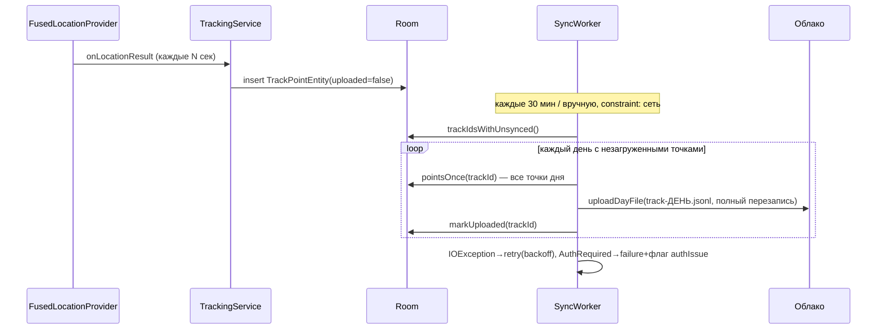

# Архитектура TraceDay

## Слои

```mermaid
flow TD
    subgraph UI["UI (Compose, MVVM)"]
        Map["Карта (osmdroid)"]
        History["История"]
        Settings["Настройки"]
    end
    subgraph Domain
        Models["Модели, статистика"]
        Utils["Дни, гео, ссылки, retention"]
    end
    subgraph Data
        Room["Room (tracks, points)"]
        DataStore["DataStore (настройки)"]
    end
    subgraph Background
        Svc["TrackingService\n(foreground, location)"]
        Sync["SyncWorker (30 мин)"]
        Clean["CleanupWorker (24 ч)"]
        Boot["BootReceiver"]
    end
    subgraph Cloud
        Repo["CloudRepository"]
        G["GoogleDriveClient\n+ OAuth (GoogleAuthUtil)"]
        Y["YandexDiskClient\n+ OAuth 2.0 (Custom Tabs)"]
        Imp["TrackImporter"]
    end

    UI --> Room
    UI --> DataStore
    UI --> Repo
    Svc --> Room
    Sync --> Room
    Sync --> Repo
    Clean --> Room
    Clean --> Repo
    Boot --> Svc
    Repo --> G
    Repo --> Y
    UI --> Imp
    Imp --> G
    Imp --> Y
```

## Модель данных (Room)

- `tracks`: `id` (`self-YYYY-MM-DD` для своих дней, UUID для импортированных), `title`, `kind` (SELF/IMPORTED), `sourceUrl`, `publicUrl`, `colorArgb`, `enabled`, `addedAt`
- `points`: PK (`trackId`, `timestamp`), `lat`, `lon`, `accuracy`, `provider`, `uploaded` — FK на tracks с CASCADE-удалением
- Ключевая идея: единая таблица точек и для своих, и для импортированных треков; «день» = трек `self-<дата>`

## Поток записи



Формат файла — JSONL, одна точка на строку:

```json
{"t":1793654400000,"lat":55.7558,"lon":37.6173,"acc":8.5,"p":"fused"}
```

## Облачная абстракция

`CloudClient` (интерфейс): `ensureStorage`, `listDayFiles`, `uploadDayFile`, `publishDayFile`, `downloadShared`, `deleteFilesOlderThan`. Реализации:

- **GoogleDriveClient**: настраиваемая папка (Настройки → «Путь к папке TraceDay», пусто = корень; итоговый путь `<родитель>/TraceDay`, вложенные сегменты создаются по цепочке от корня, id кэшируется); создание файла метаданными + `uploadType=media` (перезапись); публикация — permission `anyone/reader` + `webViewLink`; токен через `GoogleAuthUtil` (аккаунт из Google Sign-In), refresh и инвалидация в OkHttp-интерцепторе (401 → clearToken → повтор)
- **YandexDiskClient**: путь `/<родитель>/TraceDay` на диске (сегменты создаются, 409 игнорируется); upload через временный `href` (PUT без авторизации — предподписанная ссылка); публикация — `publish` + `public_url`; OAuth: код по redirect `traceday://oauth2` (Custom Tabs, state-проверка) → обмен/refresh на `oauth.yandex.ru/token`; импорт публичных ссылок — `public/resources/download` без авторизации

Выбор провайдера — настройка в DataStore; `CloudRepository` маршрутизирует и хранит состояние авторизации (`TokenStore` на EncryptedSharedPreferences + StateFlow для UI).

## Импорт трека по ссылке

`LinkParser` распознаёт: `drive.google.com/file/d/<id>`, `open?id=`, `uc?id=`; `disk.yandex.ru|yadi.sk|360.yandex.ru/d/<key>`; произвольный URL. Далее `TrackImporter`: скачивание (Google — API с токеном либо публичный `uc?export=download`; Яндекс — публичный download-эндпоинт; остальное — прямой GET) → декод JSONL → замена трека с тем же `sourceUrl` → вставка `tracks` + `points(uploaded=true)`.

Обновление чужих треков: `MapViewModel.refreshImported()` вызывается при входе на экран карты (`LaunchedEffect(Unit)`), троттлинг 10 минут; обновляются только треки с `enabled=true` и непустым `sourceUrl` (метод `TrackImporter.refresh` перезаливает точки по ссылке-источнику). Уход с экрана карты / скрытие чипа / фон приложения — обновления прекращаются.

## Устойчивость

| Ситуация | Поведение |
|---|---|
| Нет сети | точки копятся в Room (`uploaded=false`), SyncWorker ждёт constraint CONNECTED, retry с экспоненциальным backoff |
| Истёк/отозван токен | интерцептор обновляет (Яндекс refresh_token; Google GoogleAuthUtil) при 401; при провоге — `AuthRequiredException`, флаг `authIssue` → баннер в UI «Нужна повторная авторизация» |
| Убийство процесса | сервис START_STICKY, флаг `trackingRunning` в DataStore, BootReceiver поднимает запись после перезагрузки (опция) |
| Смена дня на ходу | сервис создаёт новый трек `self-<новая дата>` при первом фиксe после полуночи |
| Повторная загрузка дня | файл дня перезаписывается целиком по локальным данным — идемпотентно |
| VPN/прокси | обычные HTTPS-запросы к googleapis.com / cloud-api.yandex.net |

## Хранение (7 дней)

`CleanupWorker` (раз в сутки): локально — треки, у которых `MAX(timestamp) < now-7d`, удаляются с каскадом точек; в облаке — файлы `track-*` с датой изменения старее cutoff удаляются через API провайдера.

## UI

- Тёмная Material 3 тема, нижняя навигация: Карта / История / Настройки
- Карта (osmdroid в `AndroidView`): полилинии на трек (свой — синий, импортированные — палитра), маркеры старт/финиш, авто-зум по bbox; чипы дней (7), фильтры «1/3/6 ч/весь день», панель статистики и статус синхронизации, FAB записи с пульсацией, FAB импорта, чипы импортированных треков
- История: карточки дней (дистанция, время, точки, облачный статус) → переход на карту
- Настройки: интервал, режим точности, автостарт после загрузки; выбор облака, вход/выход, «Синхронизировать сейчас»; очистка локальных данных

## Тесты

`app/src/test`: `TrackFileCodecTest` (JSONL roundtrip, битые строки), `LinkParserTest` (все виды ссылок), `DayKeysTest` (границы дня, имена файлов, зоны), `TrackStatsCalculatorTest` (гаверсинус, фильтр телепортов 1000 км, сортировка), `RetentionPolicyTest`, `TrackDaoTest` (Robolectric: диапазонные запросы, флаг uploaded, каскадные удаления, агрегаты).
